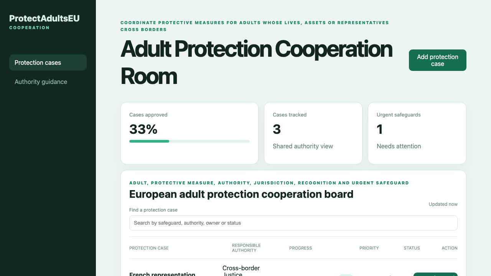

# Adult Protection Cooperation Room

## One-sentence benefit

Help central authorities coordinate protective measures for adults across European borders.

## Live demo

[Watch the workflow](docs/demo.webm).

## Screenshots

## Main features

- Search and sort protection cases by adult, authority, status or urgency.
- Create a realistic safeguard request and advance it through review and approval.
- Present operational cases and authority guidance on separate routes.
- Show loading, empty and error feedback using live backend records.

## Technology used

Vue 3, TypeScript, Pinia, Vue Router, Vite, Spring Boot and Java 21.

## Installation instructions

Install Node.js 22 and Java 21. Run `npm install`, start `cd backend && mvn spring-boot:run`, then run `npm run dev`.

## Commercial licensing/contact

Commercial licensing and integration support are available through the repository contact options.

## Business problem and users

Central authorities, courts, social services and representatives need a shared view when jurisdiction, recognition or urgent safeguards span Member States.

## Key workflows

Review a case, search by authority, create an urgent safeguard, advance recognition and read cooperation guidance.

## Vue framework highlights

Pinia composition stores manage asynchronous state, Vue Router provides multiple pages and computed properties drive filtered summaries.

## Java backend highlights

Spring Boot implements validated list, search, create and update endpoints, clear errors, layered domain logic, health status and Java tests.

## Architecture and state flow

Vue calls `/api/items`; Spring validates input, services update the register and Pinia reflects returned records.

## Accessibility and responsive behaviour

Labelled search, semantic navigation, readable status cues, keyboard controls and responsive panels support varied users and devices.

## Verification commands

Run `npm test`, `npm run lint --if-present`, `npm run build`, `cd backend && mvn test` and `cd backend && mvn package`.

## Structure

`src` contains views and Pinia, `backend` contains Java and `docs` contains inspected media.

## Tradeoffs

The sample avoids sensitive personal data and uses memory storage; production requires encryption, roles and national justice integrations.

## Roadmap

Add multilingual forms, representation documents, jurisdiction timelines, secure transfer and rights-based audit reports.
